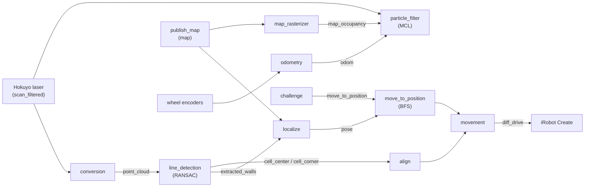

# Robotics Fundamentals: Autonomous Maze Navigation with an iRobot Create

Project from the **Robotics Fundamentals Praktikum** at the Robotics and Biology Laboratory (Prof. Oliver Brock), TU Berlin. **I worked on every part of the navigation stack and implemented the RANSAC wall extraction and the particle filter myself.**

A mobile robot is placed somewhere in a known maze. Using only its laser scanner and wheel encoders, it has to figure out where it is, drive to a set of target cells ("gold"), and leave the maze through an exit cell, recovering on its own if it gets picked up and moved during the run.

The navigation stack is written in **C++ on ROS 2 (Jazzy)**, with **Eigen** for the geometry.

**Hardware:** iRobot Create (differential drive), Hokuyo URG laser scanner

---

## What's implemented

| Capability | How |
|---|---|
| **Wall extraction from laser scans** | RANSAC, implemented from scratch: repeatedly fits line segments to the scan point cloud, rejects segments with gaps, refines each wall with a PCA (total least squares) fit |
| **Cell alignment** | Intersects perpendicular walls to find the nearest cell corner and center, then drives the robot to the center of its current cell |
| **Discrete localization in the maze** | Matches the walls the robot observes against the known maze map (in all four orientations) to determine the robot's cell and heading |
| **Kidnapped-robot recovery** | Detects when observations no longer match the expected cell, re-aligns and re-localizes automatically |
| **Monte Carlo localization** | Particle filter (2000 particles by default) with an odometry motion model and a likelihood-field laser model built from a precomputed distance map of the maze |
| **Odometry** | Pose integration from the wheel encoders |
| **Path planning** | Breadth-first search over the maze cells, converted into a sequence of drive commands |
| **Mission logic ("challenge")** | Visits the reachable gold cells nearest first, then heads for the nearest reachable exit |

## My contribution

- **Whole stack:** worked on every component: wall detection, cell alignment, maze localization, path planning and the mission logic
- **RANSAC wall extraction** (`line_detection.cpp`, implemented myself): fits wall segments to the laser point cloud one after another, rejects segments with gaps, refines each wall with a PCA fit, and estimates the nearest cell corner and center for alignment
- **Monte Carlo localization** (`particle_filter.cpp`, implemented myself): particle filter with an odometry motion model, a likelihood-field laser model built from a precomputed distance map of the maze, and resampling

## Project status

The components were developed and tested on the physical robot during the Praktikum. The complete mission, collecting every gold cell and leaving the maze in a single run, did not work reliably end to end.

---

## Architecture



### Nodes (`src/red_fundamentals/src/`)

| Node | Purpose |
|---|---|
| `conversion` | Converts the filtered laser scan into a 2D point cloud |
| `line_detection` | RANSAC wall extraction, cell corner and center estimation |
| `align` | Centers and orients the robot inside its current cell |
| `localize` | Maze localization by wall matching, kidnapped-robot recovery |
| `particle_filter` | Monte Carlo localization with a likelihood-field sensor model |
| `odometry` | Wheel-encoder odometry |
| `map_rasterizer` | Turns the maze description into an occupancy grid for the particle filter |
| `move_to_position` | BFS path planning to a target cell |
| `grid_fast` | Executes cell-to-cell plans with position correction |
| `movement` | Queue of drive commands sent to the robot (`add_move`, `abort_move`, ...) |
| `challenge` | Mission logic: collect gold cells, then exit the maze |

---

## Repository layout

```
src/
├── red_fundamentals/     # the team's code: all nodes above, messages, services, launch files, scripts
├── map_and_messages/     # maze map message definitions and a map publisher
└── create_fundamentals/  # iRobot Create + Hokuyo ROS 2 driver, provided by the course
```

---

## Build and run

Requirements: ROS 2 Jazzy, Eigen 3, `laser_filters`.

```bash
colcon build
source install/setup.bash

# robot driver and laser
ros2 launch create_fundamentals robot_and_laser.launch.py

# localization, alignment and planning stack
ros2 launch red_fundamentals planning.launch.py

# the full mission
ros2 launch red_fundamentals challenge.launch.py \
    gold_file:=src/red_fundamentals/data/gold.txt \
    pickup_file:=src/red_fundamentals/data/pickup.txt
```

`src/red_fundamentals/scripts/start.bash` starts the complete stack, including the particle filter, in a tmux session.

---

*Course project, built in a team. The `create_fundamentals` driver package was provided by the course.*
